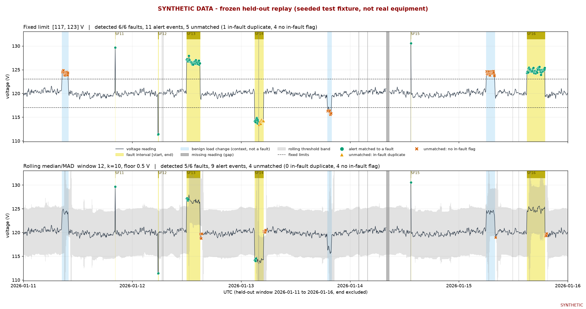

# Held-out replay report

**SYNTHETIC DATA - seeded test fixture; results do not describe real equipment.** Conclusions below are scoped to this one seeded synthetic replay. They are not evidence about real equipment and settings were not changed after seeing results.

## Freeze record

- Window: 2026-01-11T00:00:00Z to 2026-01-16T00:00:00Z (end excluded), 5-minute cadence, seed 20260101.
- Frozen settings read from `config/frozen_config.json` (SHA-256 `2735a40ba5b425682b301e3beec4bcbc4f936af6e1f7cf8e818dc8e74accd4f1`; file not modified):
  fixed limit [117, 123] V; rolling median/MAD window 12, k 10, floor 0.5 V, MAD scale 1.4826.
- All four recorded fixture SHA-256 hashes matched before the run. Earlier readings initialised rolling history; only shared eligible held-out slots were grouped and scored.

## Headline metrics (frozen scoring rules)

| Metric | Fixed limit | Rolling median/MAD |
|---|---|---|
| Scheduled slots | 1440 | 1440 |
| Valid slots | 1423 | 1423 |
| Eligible slots (shared) | 1423 | 1423 |
| Coverage: valid / scheduled | 0.9882 | 0.9882 |
| Coverage: eligible / scheduled | 0.9882 | 0.9882 |
| Monitored sensor-hours | 118.583 | 118.583 |
| Faults detected / total | 6 / 6 | 5 / 6 |
| Faults missed | 0 | 1 |
| Alert events | 11 | 9 |
| Unmatched alert events | 5 | 4 |
| Unmatched per 24 monitored sensor-hours | 1.012 | 0.810 |
|   of which in-fault duplicates | 1 | 0 |
|   of which no in-fault flag | 4 | 4 |
| Mean latency over detected faults (min) | 0.0 | 0.0 |

Unmatched = alert events not matched one-to-one to a fault. *In-fault duplicate*: has a flag inside a fault interval whose match went to another alert. *No in-fault flag*: no flag inside any fault interval.

Informational counts (not part of the headline metrics): unmatched events overlapping a labelled benign load change - fixed 4, rolling 0; unmatched events starting within 60 min after a fault ends - fixed 0, rolling 3.

## Per-fault latency

| Fault | Type | Injected (V) | Onset (UTC) | Fixed latency (min) | Rolling latency (min) |
|---|---|---|---|---|---|
| SF11 | spike | +9.5 | 2026-01-11T20:15:00Z | 0 | 0 |
| SF12 | spike | -8.5 | 2026-01-12T05:40:00Z | 0 | 0 |
| SF13 | sustained_shift | +6.8 | 2026-01-12T12:00:00Z | 0 | 0 |
| SF14 | sustained_shift | -6.2 | 2026-01-13T03:00:00Z | 0 | 0 |
| SF15 | spike | +10.5 | 2026-01-14T13:25:00Z | 0 | 0 |
| SF16 | sustained_shift | +5.2 | 2026-01-15T15:00:00Z | 0 | missed |

Latency = first in-fault flag minus fault onset. Alert start is reported separately in `heldout_per_fault.csv`.

## Observed failure case

Selection rule: Fixed before looking at results. 1) The earliest-onset fault missed by either method (fixed limit first on ties). 2) Else the earliest sustained shift whose in-fault slots the rolling detector stopped flagging (adaptation). 3) Else the earliest unmatched alert overlapping a benign load change.

**Case type: missed fault - rolling median/MAD detector, fault SF16** (sustained shift, +5.2 V injected, 2026-01-15T15:00:00Z to 2026-01-15T19:00:00Z, 48 eligible slots).

No alert had a flag inside the fault interval: 0 of 48 in-fault slots were flagged. In-fault voltage ranged 123.94 to 125.59 V against rolling median/MAD thresholds spanning 87.73 to 156.97 V. The closest approach was 0.29 V inside the nearest threshold at 2026-01-15T15:05:00Z (voltage 124.61 V, thresholds [114.90, 124.90] V).

The rolling median was 119.86 V in the last eligible slot before onset (2026-01-15T14:55:00Z) and 124.94 V at the last in-fault slot (2026-01-15T18:55:00Z): the window moved with the shifted level, so the threshold band ([119.94, 129.94] V at that slot) followed the voltage. The fixed-limit detector on the same slots detected it with latency 0 min.

Just before onset the band half-width was 5.00 V (k x spread). The first in-fault voltages (124.31 and 124.61 V) stayed under the upper threshold (124.89 and 124.90 V). Once the 12-slot window held a mix of pre- and post-shift values the band widened to 69.24 V total at 2026-01-15T15:30:00Z, which further reduced the chance of a flag.

| window | UTC (MM-DD HH:MM) | V | fault | fixed upper | fixed flag | rolling median | rolling band | rolling flag |
|---|---|---|---|---|---|---|---|---|
| onset | 01-15 14:45 | 119.94 |  | 123.0 |  | 119.90 | [114.90, 124.90] |  |
| onset | 01-15 14:50 | 119.64 |  | 123.0 |  | 119.90 | [114.90, 124.90] |  |
| onset | 01-15 14:55 | 119.89 |  | 123.0 |  | 119.86 | [114.86, 124.86] |  |
| onset | 01-15 15:00 | 124.31 | SF16 | 123.0 | Y | 119.89 | [114.89, 124.89] |  |
| onset | 01-15 15:05 | 124.61 | SF16 | 123.0 | Y | 119.90 | [114.90, 124.90] |  |
| onset | 01-15 15:10 | 124.35 | SF16 | 123.0 | Y | 119.92 | [114.92, 124.92] |  |
| onset | 01-15 15:15 | 124.46 | SF16 | 123.0 | Y | 120.07 | [115.07, 125.07] |  |
| onset | 01-15 15:20 | 125.24 | SF16 | 123.0 | Y | 120.09 | [114.53, 125.64] |  |
| onset | 01-15 15:25 | 125.46 | SF16 | 123.0 | Y | 120.31 | [112.23, 128.39] |  |
| onset | 01-15 15:30 | 125.18 | SF16 | 123.0 | Y | 122.35 | [87.73, 156.97] |  |
| onset | 01-15 15:35 | 125.00 | SF16 | 123.0 | Y | 124.33 | [109.21, 139.45] |  |
| onset | 01-15 15:40 | 125.10 | SF16 | 123.0 | Y | 124.41 | [112.47, 136.34] |  |
| onset | 01-15 15:45 | 124.65 | SF16 | 123.0 | Y | 124.53 | [115.57, 133.50] |  |
| onset | 01-15 15:50 | 124.80 | SF16 | 123.0 | Y | 124.63 | [118.40, 130.86] |  |
| onset | 01-15 15:55 | 124.59 | SF16 | 123.0 | Y | 124.72 | [119.17, 130.28] |  |
| end | 01-15 18:40 | 124.96 | SF16 | 123.0 | Y | 124.94 | [119.94, 129.94] |  |
| end | 01-15 18:45 | 125.14 | SF16 | 123.0 | Y | 124.94 | [119.94, 129.94] |  |
| end | 01-15 18:50 | 125.03 | SF16 | 123.0 | Y | 124.94 | [119.94, 129.94] |  |
| end | 01-15 18:55 | 125.39 | SF16 | 123.0 | Y | 124.94 | [119.94, 129.94] |  |
| end | 01-15 19:00 | 119.27 |  | 123.0 |  | 124.95 | [119.95, 129.95] | Y |
| end | 01-15 19:05 | 119.56 |  | 123.0 |  | 124.95 | [119.95, 129.95] | Y |
| end | 01-15 19:10 | 119.52 |  | 123.0 |  | 124.95 | [119.95, 129.95] | Y |
| end | 01-15 19:15 | 119.31 |  | 123.0 |  | 124.95 | [119.95, 129.95] | Y |
| end | 01-15 19:20 | 119.81 |  | 123.0 |  | 124.84 | [119.84, 129.84] | Y |
| end | 01-15 19:25 | 119.79 |  | 123.0 |  | 124.67 | [115.85, 133.49] |  |

Full slot-level evidence: `heldout_failure_case_evidence.csv`.

## Chart

## Files

`heldout_metrics.json`, `heldout_alerts.csv` (per-event triggering voltage, threshold, direction, reason, contributing flags, matched fault), `heldout_per_fault.csv`, `heldout_failure_case_evidence.csv`, `heldout_chart.png`.

## Scope and open assumptions

- One seeded synthetic series; six faults per method. No confidence intervals, no repeated seeds. Differences between methods here may not carry over to other seeds or to any real data.
- Frozen settings came from a narrow grid and a provisional 1.0 per 24 h false-alert budget.
- Under the contract a sustained shift split into several alerts adds unmatched events, and a detector that flags the return to normal after a shift ends is charged an unmatched event.
- The 60-minute after-fault count is informational only.
